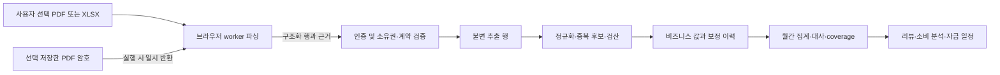

# Personal Finance 구현 아키텍처와 금융정보 보호 설계

상태: PIN-67 확정 정책과 PIN-68/69/70 구현을 반영한 현행 경계, 2026-10-28. 아래 과거 설계 후보 중 수기·삭제·내보내기는 다음 구현 절이 우선한다. 운영 적용·사용자 기능 검증은 별도 기록한다.

제품 기준은 [PIN-16 Product Mission v0.1](https://linear.app/pin-dev/issue/PIN-16)의 월간 관리 부담 감소, 금융 흐름·변화 이해, 근거 있는 발견이다. 현재 목적 문장의 승인 원본은 PIN-16이다. 정식 제품 문서의 위치·진입점을 develop 기준으로 확인하고 별도 문서 변경을 병합한 뒤 단일 기준을 이전한다. 이 설계가 제품 목적 원문을 대신하지 않는다.

## 근거와 결정 수준

- [PIN-37](https://linear.app/pin-dev/issue/PIN-37): 상세 은행 원천은 월급·소비 통장 1개, 카드는 독립 원천, 달력 월·월 1회 리뷰, 다중 파일과 예외 중심 처리, 사용자 보정 보존, 선택적 PDF 암호 저장. Investments는 후속이다.
- [PIN-39](https://linear.app/pin-dev/issue/PIN-39) 2026-10-25 PoC: 텍스트 PDF와 실제 ZIP/OOXML 카드 XLSX를 로컬 Chrome 모바일 viewport에서 판독하고 주요 필드를 독립 검산했다. 실제 Android, 다른 파일 간 중복·정정, 전체 카드 소비 완전성, 기간이 맞는 은행·카드 대사는 미검증이다. 원파일·개인 값·hash는 이 문서에 복제하지 않는다.
- 참고 대화 ‘거래 데이터 테이블 설계’(`6adcd33b-2d04-83e8-bebb-d43e237cd083`): 사용자는 Raw의 필요성·비즈니스 값 우선·MVP 가치와 개발 학습 목적을 질문했다. 이전 답변 본문은 도구에서 참조 표시로만 반환되므로 당시 합의로 취급하지 않는다.
- 아래의 **채택안**은 이번 설계의 권고 결정이다. 물리 ERD, 세부 이름, 출시 보존 기한, 키 공급 방식은 구현 요청·확인 게이트를 거쳐 확정한다. 새 개발 이슈/PR에는 위 제품 기준 중 기여 항목과 검증 여정을 기재한다.

## 채택안과 대안

| 결정 | 채택안과 이유 | 대안·전환 조건 |
| --- | --- | --- |
| 파일 처리 | 브라우저 worker에서 복호화·파싱, 필요한 구조화 행만 서버 전송. PoC 경로를 이어가고 원파일의 서버 보존을 피한다. | 서버 파싱은 Android 자원/호환성 검증 실패 시 재검토. 원본 전송·임시 저장·삭제·비용을 다시 설계하며 조용히 fallback하지 않는다. |
| 저장 구조 | 문서별 최소 불변 Raw 행 → 정규화/검증 → 비즈니스 레코드와 보정 이력. 중복 처리·트랜잭션·revision·재처리를 학습하되 범용 ETL은 만들지 않는다. | 제품 기능만 보면 원본 참조를 포함한 단일 모델도 가능하다. Raw 자체가 중복 방지·정확성·MVP 가치의 증거는 아니다. |
| 계산 | 서버의 검증 가능한 코드가 집계·포함/제외·대사를 소유. FE는 결과와 근거를 표시한다. | AI는 첫 출시의 필수 의존이 아니다. |
| 배포 | 현재 React Router/TanStack Query/FSD, Fastify 주입, Drizzle/Neon, 쿠키 JWT 유지. 동기식·제한된 요청 단위 처리. | 실제 처리량·시간·비용 증거가 있어야 큐/worker/스케줄러를 추가한다. |

브라우저 파싱 결과는 신뢰할 수 없는 사용자 입력이다. 서버는 계약·크기·금액·행 연결·소유권·대사를 다시 검증한다. 원파일을 받지 않는 이상 파일 hash나 대사 성공으로 은행 발행 진위·변조 부재를 증명할 수 없다. 제품은 ‘사용자가 가져온 자료’로 표시한다.

## 계층과 변경 책임

경로는 저장소 루트 기준이며 신규 이름은 후보이다. 기존 개발 전용 시안의 합성 어댑터를 운영 계산으로 승격하지 않는다.

| 계층 | 구현 시 책임 |
| --- | --- |
| `packages/contracts` | money/date/coverage/provenance/revision, 가져오기·보정·암호·오류 DTO의 Zod 스키마. 원천에 없는 식별자를 만들었다고 표현하지 않는다. |
| Web `app` | Provider·보호 세션 lifecycle·서버 어댑터 조립. 현행 시안 entry와 운영 진입 분리. |
| Web `pages/motifin` | route adapter와 loader/action, 월·필터·상세 탐색. 실제 개인정보는 URL에 싣지 않는다. |
| Web `features` | import worker 수명, command·재시도·보정·파일 선택 상태. `entities`의 API를 호출하고 세션 경계를 검사한다. |
| Web `entities/cash-flow` | query key/options·API·읽기 모델. 서버 상태를 단일 QueryClient로 관리한다. |
| API `src/routes` | 인증·승인·기대 사용자 일치·입력/출력 스키마·CSRF·용량 제한. 원문 오류를 안전한 코드로 변환. |
| API domain/service | source와 business의 연결, 중복/보정 정책, 계산·대사·revision·부분 실패 처리. 거대한 공통 금융 엔진을 만들지 않는다. |
| API `src/db` | 소유권이 필수인 repository, 원자적 반영·조건부 갱신·readback. `buildApp`에 repository와 secret provider를 주입한다. |

현재 `src/auth.ts`는 매 요청 DB 사용자 승인/역할을 확인하고 JWT/쿠키는 15분 만료다. 금융 소유권·금융 query 등록·PDF 암호 저장은 아직 없다. `src/app.ts`의 예상 밖 오류는 `err` 객체를 기록하므로 파서·DB·암호 오류가 이 경로로 원문 전달되지 않도록 해야 한다. 기존 password/token redaction만으로 금융 보호가 완성됐다고 보지 않는다.

DB 변경은 금융 전용 테이블/인덱스·owner 참조를 추가하는 additive migration으로 계획한다. 기존 Exam/Curriculum 테이블·공용 콘텐츠 권한을 개인 금융 의미로 재사용하거나 일괄 변환하지 않는다. 적용 전 dev branch 대상·스키마 diff·복구 계획과 기존 데이터 보존을 확인하며, 정식 migration 생성/실행은 이번 설계에 포함하지 않는다.

## 논리 모델과 Raw의 역할

논리 책임을 나열한 것이며 테이블 수·컬럼명을 확정하지 않는다.

| 책임 | 최소 보존 내용·불변 조건 |
| --- | --- |
| 금융 원천 | 서버 생성 ID, owner, 은행/카드 의미, 표시 별칭, 필요한 식별 범위. 카드는 은행의 자식이 아니며 결제계좌 연결은 기간과 근거를 가진 별도 관계다. |
| 원문 문서 | owner/source, 바이트 SHA-256, 실제 형식, 자료가 제공한 기간/제어 합계, parser version, 수집 시각. filename은 식별키·청구월 근거가 아니며 기본 서버 비보관. |
| 가져오기 시도/파일 항목 | operation ID, 파일별 상태, 결과 revision, payload digest, 처리 건수와 안전한 오류 코드. 실패·중복·정정 대기를 구별한다. |
| Raw 추출 행 | 문서·parser version·page/sheet/row/sequence·row-kind·parent-row, 필요한 원문 셀과 null/부호. 전체 PDF 텍스트·전체 workbook 덤프는 저장하지 않는다. 같은 문서의 동일 파싱 결과를 재업로드 때마다 복제하지 않는다. |
| 비즈니스 은행 거래 | 안정된 내부 ID, 원천 행 참조, 현재 해석된 입출금/거래일/명칭/메모, 거래 후 잔액 근거. 실제 현금 기록과 소비 분류를 구별한다. |
| 비즈니스 카드 기록 | 이용 관측과 청구 회차·조정·수수료·잔여 할부를 구별. 이용 관측을 곧바로 고유 구매로 확정하지 않는다. 여러 관측을 구매 하나로 연결하는 경우 근거를 보존한다. |
| 보정/분류/배분/연결 | 대상 내부 ID, base revision, 변경 필드, 이전/새 값, 적용자/시각/사유. 사용자 확정과 자동 제안의 출처를 구별한다. 원천 행은 수정하지 않는다. |
| 자료 범위·요약 | 원천별 포함 기간·as-of·완전성/누락, 원천 및 보정 revision, 계산·분류 버전, 생성 시각. |
| 일정 | 사용자 계획·반복 회차·예상/확인/미확인·실제 거래 연결. 실제 은행 거래를 계획 수정으로 바꾸지 않는다. |

일반 집계는 **현재 유효한 비즈니스 값**을 사용한다. 비즈니스 테이블마다 `originalAmount`와 `correctedAmount`를 강제하지 않는다. 불변 Raw/원천 revision에서 보정 전 값을 확인하고 현재 비즈니스 값·변경 이력으로 복원/충돌을 다룰 수 있다. 필요하면 읽기 DTO에 `sourceValue`와 `effectiveValue`를 함께 제공하되 물리 중복 저장과 구별한다.

최초 원천은 별도 사전 등록을 강제하지 않고 파일 반영 과정에서 만든다. 은행 계좌번호처럼 확보 가능한 식별자는 owner·기관 범위의 전용 keyed HMAC으로 비교하고 원문이 필요한 최소 식별값은 암호화한다. 마스킹된 번호/카드 표시명만으로 원천을 자동 병합하지 않는다. 식별이 모호하거나 다른 계좌이면 필요한 확인/파일 제외만 제공한다. hash/HMAC·암호화 키의 용도는 분리하며 원천 식별키 교체 때 기존 연결을 검증한다.

Raw를 선택하는 학습 목표는 적재→정규화→중복 후보→원자적 승격, 원천/사용자 변경의 경계, parser 변경과 금융 정정의 구분이다. Raw가 있더라도 고유 거래 ID가 생기지 않는다. 원파일을 보관하지 않으므로 새 PDF 추출기를 실행하려면 파일을 다시 선택해야 한다. 저장된 최소 Raw로 가능한 것은 이후 정규화/규칙 재처리이며 완전한 문서 재파싱이 아니다. 수동 재처리를 별도 고객 기능으로 선행 구현하지 않는다.

## 원천 의미·정밀도·월별 완전성

- 금액은 JSON 정수 문자열 + `currency` + `scale`, 서버는 정수/정확한 decimal 연산을 사용한다. 첫 지원은 검증된 KRW scale 0이며 범위·부호·합계 overflow를 검사한다. 이진 부동소수점 합계를 쓰지 않는다. 미래 수량/환율은 정확한 decimal 계약을 별도 설계하고 현재 MVP에 추가하지 않는다.
- `unknown`/빈 셀과 0을 구별한다. 원문 날짜·은행 초 단위 시각·행 순서를 보존한다. timezone은 원천에 없으므로 명시된 제품 해석과 `inferred` 근거를 기록하고 UTC로 임의 변환하지 않는다. 카드 YY 연도도 허용 기간 밖이면 확인한다.
- 은행은 입금·출금·거래 후 잔액과 문서 제어 합계를 검산한다. 기초 잔액은 첫 거래 역산이면 `inferred`; ‘총 잔액’, ‘출금가능금액’, 조회기간 기말을 동일시하지 않는다. 같은 timestamp여도 원문 sequence를 함부로 바꾸지 않는다.
- 카드의 이용금액·금회 원금·수수료·잔여 할부·포인트는 별도 의미다. 보조행의 음수 이용금액과 음수 수수료는 부모행 조정으로 보존한다. 원문의 구분만으로 취소 확정·환불일 생성·새 구매 생성을 하지 않는다. 의미 미확정 보조 셀은 최소 근거로 보존하고 해석 불명 상태를 둔다.
- 할부 구매는 확인된 구매 한 건만 구매월 소비로, 회차별 원금은 청구/현금으로 계산한다. 표본의 회차 표시만으로 파일 간 고유 구매 연결이 증명되지 않으므로 모호한 구매는 확정 총소비에서 제외하고 확인 대상으로 표시한다.
- 은행 카드대금 출금은 통장 현금 유출이며 카드 소비에 다시 더하지 않는다. 한쪽 원천에 관측된 타계좌 이동은 상대 잔액·순자산·매수/투자 목적을 생성하지 않는다. 카드/체크카드 대응·환불 연결은 확정 근거가 있을 때만 적용한다.
- 범위 상태는 지표별 `complete | partial | unknown`과 근거/누락을 가진다. 은행 조회기간과 카드 이용 관측/청구 범위를 따로 반환한다. 카드 파일명 날짜를 청구월로 쓰지 않는다. 사용자가 청구월을 확인해도 전체 달력 월 승인·취소의 완전성을 증명하지 않는다.
- 현재 표본만으로 전체 월 소비·비중·전월 대비 감소를 확정할 수 없다. ‘확보한 자료에서 확인된 금액’과 누락을 표시하고 전체 지표/변화 탐지는 보류한다. 소비 확정·분류만 미확정이면 미분류로 총소비에 포함한다.

## 반영·재처리·충돌과 보정

1. 파일 선택으로 배치를 시작한다. signature/content/지원 형식·용량·row 수·PDF 페이지·ZIP 해제 크기/압축률·worker 시간 상한을 검사한다. 상한 수치는 실제 Android 프로파일링과 합성 손상/대용량 검증으로 고정하기 전 출시하지 않는다. 파일 확장자만 믿거나 XLSX를 구형 XLS 전체 지원으로 표시하지 않는다. PDF 스크립트·매크로·외부 링크/수식 실행은 허용하지 않는다.
2. 서버는 파일별 원자적 반영을 기본으로 한다. 유효한 한 파일 안 Raw·business·반영 결과를 같은 트랜잭션에 커밋한다. 읽기 실패·정합성 오류·미해결 중복/값 충돌은 해당 파일 전체를 보류하고 잘린 자료로 완료하지 않는다. 다른 파일은 독립 성공 가능하며 성공 파일은 재시도 때 되돌리지 않는다.
3. 정렬/페이지 구조 등 파서 버그 의심과 보조 분류 실패를 구분한다. 구조·소유권·대사 불일치는 차단, 분류/매칭만 실패하면 원천 반영 후 미분류/미연결을 반환할 수 있다. 선택적 암호 저장 실패는 원장 저장 결과와 별도 표시한다.
4. 같은 owner/source/동일 바이트 hash의 문서는 기본 no-op다. 서버는 제출 내용의 정규화 payload digest도 검증한다. 동일 hash를 주장하며 내용이 다르면 충돌로 거부한다. 같은 원파일의 parser version 변경은 자동 중복 경로로 덮지 않고 별도 재처리 revision을 만든다.
5. 서로 다른 문서는 날짜·금액·표시값 전체가 같아도 별도 거래일 수 있다. 은행 겹친 기간·연속 잔액·원문 순서와 카드 회차/조정 등은 후보 근거일 뿐이다. 초기에는 미검증 교차 파일 중복을 자동 제거하지 않는다. 겹치거나 연결이 모호하면 해당 파일을 보류하고 기존 연결/별도 거래/문서 제외를 확인한다. 명백히 독립된 기간·원천의 유효 파일은 정상 반영한다.
6. 소유권 범위 `operationId + itemId`에 유일성을 두고 요청 digest를 저장한다. 같은 키·같은 내용은 같은 결과, 같은 키·다른 내용은 409. 문서 중복 제약과 operation 제약을 함께 두어 다른 키의 동시 업로드도 1회 반영한다. hash는 진위 증명이 아니며 owner 간 중복 여부를 노출하지 않는다.
7. 반영 응답을 잃으면 operation 조회로 `committed | needs-review | rejected | processing`을 확인한다. 미존재면 같은 키·같은 내용으로 재제출한다. 새 키 자동 생성·일괄 재전송은 금지한다. 성공 결과와 revision을 UI에 먼저 반영하고 재조회 실패를 저장 실패로 되돌리지 않는다.
8. 보정은 `baseRevision` 조건부 갱신이다. 오래된 편집/규칙 미리보기는 409 후 차이를 다시 검토한다. 사용자 보정·분류·배분·확정 연결은 재업로드나 신규 자동 규칙이 덮어쓰지 않는다. 규칙 일괄 적용은 대상 ID·건수·입력 revision을 고정한 미리보기 후 반영한다.

**보정 합성 사례:** 원천 카드 금액 10,000원 → 사용자 9,000원 보정 → 같은 파일 재업로드는 9,000원 유지. 다른 문서에서 8,000원이 관측됐다고 거래 동일성을 먼저 추정하지 않는다. 같은 거래의 원천 정정으로 확인되면 기존 원천/보정 유지, 새 원천+9,000원 보정 유지, 새 원천을 수용하고 해당 보정 해제 중 결과를 보여주어 선택한다. 새 원천 수용이 보정 해제를 암묵적으로 뜻하지 않는다.

첫 보정 구현은 PIN-37 시안의 카드 거래명·같은 달 날짜·금액·메모와 분류/배분이다. 금액 변경 시 기존 배분 합계가 새 금액과 일치해야 하며 모르는 차액을 임의 비례 배분하지 않는다. 원본 복원은 이력을 남기며 현재 채택된 원천 revision을 기준으로 한다.

은행 현금 보정과 월 경계를 넘는 날짜 보정은 후속 기능으로 둔다. 설계상 은행 원천 대사는 관측값을 기준으로 유지하고 비즈니스 보정 적용 시 별도 조정 차이를 표시한다. 수동 보정으로 은행 대사 PASS를 만들지 않는다. 월 이동 기능을 열 때는 이전·새 월/비교월·일정 연결·저장 리뷰의 영향을 같은 변경에서 재계산한다.

## 개인 소유권과 세션 경계

- 모든 개인 객체(Raw·document·source·operation·business·category·schedule·secret·export·요약)에 서버 인증 사용자를 소유자로 부여한다. request body `ownerId`는 받지 않는다. repository는 owner 인자를 필수로 받아 ID+owner로 조회/갱신/삭제하며 관련 객체와 join에도 같은 조건을 적용한다. 타인 ID는 미존재와 같은 404로 응답한다.
- source 연결·카테고리 배분·카드 청구↔은행 출금·보정 참조·export 범위를 모두 검사한다. 구현 시 `(owner_id, id)` 참조/제약으로 다른 owner 연결을 방지하고 트랜잭션 안에서 재검사한다. 앱의 사용자 조건이 실제 보안 경계이며 RLS 전면 도입을 전제하지 않는다.
- approved 사용자만 자신의 금융 기능에 접근한다. pending/rejected·관리자도 예외가 없다. 관리자는 승인 관리 권한만으로 타인의 금융 원문·암호·내보내기를 열 수 없다. 운영자의 인프라/DB 접근은 앱 관리자와 구별하며 별도 최소권한·접근 기록 대상이다.
- query key는 금융 prefix + user ID + session epoch + 필터, meta에 epoch를 등록한다. 보호 query 판정·취소/제거 목록과 안전한 returnTo에 운영 금융 경로를 추가한다. 기존 시안 경로를 운영 인증 경로로 간주하지 않는다.
- 파일 읽기 전후, 암호 반환 후, 파싱 종료 후, POST 전후와 cache seed 전에 epoch/현재 actor를 검사한다. 종료·로그아웃·승인 변경·계정 전환 때 worker를 종료하고 파일·암호·로컬 화면 상태·mutation 보유값·보호 query를 폐기한다. abort는 이미 커밋한 서버 작업을 되돌리지 않는다.
- 다른 탭의 쿠키 전환 경합을 위해 금융 요청에 `X-Expected-User-Id`를 실어 서버의 인증 subject와 일치시킨다. 이 값은 소유권 권한을 부여하지 않고 불일치 요청을 거부하는 fence다. focus/visibility 복귀 때 `/auth/me`를 재확인하고 탭 간 전환 알림에는 개인 본문을 싣지 않는다. 요청 후 UI에도 같은 fence를 적용한다.
- A 인증으로 시작해 B 전환 후 완료된 POST는 A 자료에만 커밋될 수 있고 B UI에 결과/원문을 표시하지 않는다. A로 재인증한 뒤 operation readback한다. 권한이 처리 중 바뀌는 긴 쓰기는 커밋 직전 상태 확인과 동시 권한 변경의 직렬화 조건을 구현 검증한다.
- 15분 만료 시 미반영 입력은 메모리에서 폐기하고 재인증 후 파일 재선택, 결과 미확인은 operation ID만 해당 세션의 복구 경로로 유지한다. 새 계정으로 자동 재제출하지 않는다. BFCache 복귀도 인증 확인 전 보호 화면을 가린다.
- 현행 JWT는 `sub` 중심이며 로그아웃으로 이미 발급된 JWT가 서버에서 즉시 폐기된다고 보장하지 않는다. 탈취 세션·XSS는 잔여 위험이다. 즉시 세션 폐기가 요구되면 PIN-49에서 별도 세션 식별/폐기 계약을 정하고 검증해야 한다.

## 선택적 PDF 암호 저장·반환

회원 생년월일로 수집하지 않고 PDF 잠금 해제용 비밀로 취급한다. 저장은 기본 해제이며 성공적으로 잠금 해제한 뒤 별도로 저장한다. 이번 결정은 ‘서버의 계정에 저장’이다. 처음 저장·변경·삭제에는 명시 동작이 필요하고 설정에는 존재 여부·갱신 시각만 제공한다. 암호 길이를 생년월일 6자리로 영구 제한하지 않는다.

| 단계 | 계약과 실패 처리 |
| --- | --- |
| 직접 입력 | 입력값은 browser/worker 메모리에서만 사용. 선택한 은행 PDF에 한해 순차 적용하고 카드·다른 기관에 무차별 시도하지 않는다. 잘못된 암호는 수동 재입력, 무한 재시도 없음. |
| 저장 | HTTPS body로 secret 전용 API에 전송. owner+기관/용도 scope를 서버가 결합하고 AEAD로 암호화. DB에는 ciphertext·nonce·tag·key version·AAD version·credential revision만 저장한다. 평문/생년월일 별도 필드·검색용 단순 hash는 만들지 않는다. |
| 재사용 시작 | 파일을 선택하고 ‘가져오기’를 실행했을 때만 owner 소유의 짧은 import-attempt(최대 10분 설계값)을 발급한다. 원파일/파일명/원문은 attempt에 넣지 않는다. 저장 상태 조회·화면 mount·prefetch에서 평문을 반환하지 않는다. |
| 평문 반환 | `POST` reveal, 인증·approved·expected user·scope·attempt 유효성·credential revision을 검사한다. 최근 재인증(설계값 5분 이내, 아니면 재로그인)과 사용자/attempt별 rate limit을 적용한다. attempt는 로그인 권한의 대체가 아니다. 성공/실패 응답 모두 no-store이며 평문은 worker에만 전달한다. |
| 종료 | 성공/실패/취소/세션 전환/attempt 만료 시 평문 참조·입력과 worker를 정리한다. JS 문자열·GC의 물리 메모리 완전 소거는 보장하지 않는다. Query/mutation 캐시·React 장기 상태·DevTools·storage에는 평문을 넣지 않는다. |
| 변경/삭제 | revision 조건부 변경, 삭제는 멱등. 요청 중인 reveal과 직렬화하고 삭제/변경 뒤 과거 revision으로 반환하지 않는다. 이미 브라우저에 반환한 평문은 회수할 수 없다. UI 저장 해제는 명시적 삭제 동작으로 연결하고 ‘이번만 직접 입력’과 구별한다. |
| 복호화 실패 | unknown key version·tag/AAD 오류·키 불가면 안전한 오류로 중단하고 수동 입력 경로 제공. 기존 ciphertext를 자동 삭제하거나 새 값으로 덮지 않는다. 원장 저장 상태와 암호 저장 실패를 분리한다. |

암호화 구체안은 유지되는 Node crypto의 AES-256-GCM, CSPRNG 96-bit nonce, 128-bit tag다. AAD는 version·owner·credential ID·기관/용도를 모호하지 않게 직렬화해 행 바꿔치기를 검출한다. 동일 key의 nonce 재사용을 막기 위한 `(keyVersion, nonce)` 유일성·충돌 재생성과 다중 인스턴스 검증을 포함한다. 복호화 결과는 tag 검증 완료 후에만 사용한다. 검증된 라이브러리를 사용하며 자체 암호 알고리즘은 만들지 않는다.

키는 JWT/DB 비밀번호·PDF 암호와 독립된 난수 키다. 우선 관리형 secret 주입/권한 분리를 검토하고 현재 호스팅에서 가능한 공급 방식·비용·rotation 절차를 출시 전 확인한다. 환경 변수 주입만 가능하면 노출 면·운영 접근·덤프 방지 한계를 명시한 제한된 대안으로 검토한다. 실제 키 생성·등록은 이번 범위가 아니다. 프런트 번들·DB·Git에 키를 두지 않는다.

키 교체는 새 version을 쓰기에 활성화 → 기존 version 읽기 병행 → 새 nonce로 재암호화·readback → 미변환/실패 건 복구 → 백업 잔존 기간 확인 후 구키 폐기 순서다. 누락 키로 수동 재입력을 요구할 수 있으나 정상 자료 손실을 성공으로 처리하지 않는다. DB 단독 유출에 대한 PDF 암호 보호이며 금융 정형 값 전체의 DB 유출·서버와 키 동시 침해·XSS·탈취 세션을 해결한다고 주장하지 않는다.

설계 근거: [OWASP Cryptographic Storage](https://cheatsheetseries.owasp.org/cheatsheets/Cryptographic_Storage_Cheat_Sheet.html)의 인증 암호화·키 분리, [Secrets Management](https://cheatsheetseries.owasp.org/cheatsheets/Secrets_Management_Cheat_Sheet.html)의 비밀 생애주기, [Node crypto](https://nodejs.org/api/crypto.html)의 AEAD API. nonce 길이·AAD 구성·API 시점·재인증 수치는 본 제품 설계안이며 실행 검증 결과가 아니다.

## 거래 생애주기 구현 — PIN-68/69/70

- 수기 수입/지출은 `finance_manual_transactions`에 독립 owner/ID/revision·생성/수정 시각과 암호화 본문으로 저장한다. 파일/Raw를 만들지 않는다. 필수 날짜·거래명·KRW 양수 정수, 선택 카테고리·메모를 검증한다. 수기 지출은 공통 분류·분할/소비 분석에, 수입은 별도 월간 수입과 일정 근거에 포함하며 은행 잔액·coverage에 더하지 않는다.
- 모든 거래 해석·수기/분류/일정 쓰기는 `finance_business_scopes`의 owner CAS를 공유한다. 읽기도 버전이 바뀌면 재조회/409로 혼합 스냅샷을 차단한다. `finance_transaction_operations`에는 owner/operation/거래 ID와 용도별 HMAC digest만 남기고 본문을 복제하지 않는다. 관리자도 타인의 자료를 읽거나 변경하지 못한다.
- 영구 삭제는 서버 영향 미리보기의 버전과 최종 의도를 확인한 단건만 지원한다. Raw 해당 행·제어 합계/메타 사본·거래·보정/분할/연결을 정리하고 분류/일정 전체 과거 암호화 이력은 폐기·현재 상태를 새 revision으로 재기준화한다. 다른 거래의 현재 보정·일정은 보존한다. 앱 복원/분석 제외/다건 삭제는 제공하지 않는다.
- 동일 Raw 행에 있던 별개 청구/수수료 이벤트는 자동 연쇄 삭제하지 않고 Raw FK를 nullable로 해제해 재검토 상태로 남긴다. 해당 거래 정보가 남는 문서 합계·원천 메타는 제거한다. 은행 잔액은 주변 잔액으로 삭제 금액을 역산하지 않도록 관련 문서의 잔액 표시를 미확인으로 전환하며 숫자를 임의 보정하지 않는다. 삭제 후 원천은 부분 자료다.
- `finance_deleted_transactions`는 owner/삭제 ID/파일·행 식별/시각만 보호 보관한다. 원문·거래 금액은 없다. 원래 파일 hash/digest 유일성과 삭제 후 남은 Raw를 함께 유지하여 동일 파일 재업로드는 기존 결과만 반환한다. 다른 파일은 날짜·금액만으로 병합하지 않는다. Raw 행 수는 0, 원천 행 번호는 누락, 거래의 원천 행 연결은 null일 수 있다.
- 내보내기는 `POST /api/finance/transactions/export`에서 현재 월 기본·연속 최대 12개월의 XLSX만 메모리에서 생성한다. 안내/거래 상세/분할 내역/월별 요약 4개 시트, 정확한 정수 텍스트와 ISO 날짜·원천/자료 상태·근거 ID를 제공한다. 문자열 셀만 기록하고 수식·외부 링크를 생성하지 않는다. 최대 15,000 거래행/30,000 배분행/8MiB, 전체 원천 조회는 50,000 이벤트로 제한하고 초과는 조용한 누락 없이 거부한다.
- 계좌·카드 식별자/PDF 비밀/키/세션은 제외한다. 거래처는 포함하고 메모는 선택 포함한다. 은행의 송금메모가 거래명에 합쳐져 반출되지 않도록 원천 적요와 메모를 분리한다. 불명 청구일은 빈값과 안내로 남기고 월 귀속을 추정하지 않는다. 내보내기 파일은 서버 저장하지 않으며 외부 AI 자동 전송은 없다.
- 원파일·이미 내려받은 사본과 백업은 즉시 삭제할 수 없다. **최신 삭제 기록을 별도 보호 확보하고 삭제를 재적용·검증하기 전 운영 복원은 금지**한다. 실제 보존/복원 조건은 PIN-48/49와 운영 담당자가 소유하며 이 구현으로 시점 복원 완료를 주장하지 않는다.

## 전송·로그·캐시·보존·내보내기

- 전체 금융 응답과 오류에 `Cache-Control: no-store`; HTTPS, credential 포함 fetch, 동일 origin 기본. CDN·Service Worker·HTTP cache·browser persistence·offline queue에 저장하지 않는다. 금융 route에는 session replay·본문 수집 Analytics를 적용하지 않는다. 계좌/카드·상대방·메모·금액·암호·원파일 hash를 URL/로그/에러/APM context에 넣지 않는다. URL은 월·고정 화면 enum·무작위 내부 ID 정도로 제한한다.
- PDF 암호처럼 저엔트로피 비밀을 범용 요청 digest/idempotency ledger에 평문·단순 hash로 남기지 않는다. secret PUT은 credential revision의 조건부 갱신과 상태 readback으로 결과를 확인한다. 금융 import digest에는 암호 필드를 포함하지 않는다.
- state-changing API와 reveal에는 JSON 전용 content type, 고정 custom request header, 허용된 Origin 검증과 엄격한 CORS를 적용한다. origin 부재의 브라우저 요청은 기본 거부하고 Fetch Metadata를 보조 확인한다. 서브도메인 wildcard credential CORS를 두지 않는다. SameSite 쿠키만으로 CSRF가 해결됐다고 보지 않는다. [OWASP CSRF 지침](https://cheatsheetseries.owasp.org/cheatsheets/Cross-Site_Request_Forgery_Prevention_Cheat_Sheet.html).
- 파서·암호·DB 예외는 원문 문자열/stack/cause를 공용 오류로 넘기지 않고 allowlist 코드·request ID·단계·duration만 기록한다. 원문 셀은 HTML로 렌더하지 않고 CSV export에는 수식 실행 방지를 적용한다. worker/CSP/외부 요청 제한과 금융 화면 제3자 script 최소화를 브라우저에서 확인한다.
- 서버 최소 Raw는 지원 컬럼 중 대사·복원·근거에 필요한 셀/행 연결만 저장한다. 계좌·카드 식별자/상대방·메모 등 민감 텍스트는 별도 용도의 암호화와 마스킹 DTO를 설계한다. 정형 금액/날짜가 조회를 위해 DB에 남는 점, DB 접근자·백업에 보이는 범위를 사용자에게 설명한다. 관리형 at-rest 암호화/백업 설정은 현행 제공자 확인 전 완료를 주장하지 않는다.
- 원파일과 PDF 평문은 서버 비보관. 정상 반영 Raw/비즈니스/이력은 사용자가 해당 자료를 보관하는 기간에 유지한다. 미반영 server staging은 최대 24시간, operation 결과는 30일(복구용 설계값) 후 본문 없이 만료시킨다. 이 기간 뒤에도 원문 문서의 중복 제약은 자료 보유 동안 유지한다. 실패한 요청에 원문을 저장하는 기본 경로는 만들지 않는다.
- 암호 삭제는 credential과 활성 attempt 폐기, 금융 자료 삭제는 Raw·비즈니스·보정·분류/매칭 연결·파생 요약·저장 리뷰 입력 사본·staging을 함께 삭제하고 관련 cache를 무효화한다. 계정 삭제는 모든 개인 자료와 secret을 포함한다. 삭제와 진행 중 import를 직렬화해 늦은 커밋으로 자료가 부활하지 않게 한다.
- 삭제 시점·대상만 최소 tombstone으로 남겨 백업 복원 뒤 재삭제한다. 백업 즉시 소거·공유 키 폐기로 특정 사용자만 완전 삭제를 약속하지 않는다. 실제 백업 보존일/만료, tombstone 수명, 복원 후 삭제 재적용·구키 보유를 PIN-49/운영 검토에서 확정하고 출시한다. 선택 저장 암호가 백업에 남을 수 있음을 안내한다.
- export는 owner만 요청·다운로드하는 no-store XLSX로 원천 근거·비즈니스 현재 값·보정/분류/연결·coverage·revision/버전을 구별해 제공한다. 원파일은 미보관이므로 포함할 수 없고 PDF 암호·key·ciphertext는 export하지 않는다. 동기 export가 한도를 넘으면 안전한 실패를 반환하고 새 큐를 자동 도입하지 않는다.
- 파일 방식에는 외부 계정 연결 권한이 없다. ‘관리 중지’는 신규 수집을 멈추고 기존 자료의 기준일을 표시하며 삭제와 구별한다. 향후 Sheets/AI 연결 철회·사본 삭제는 실제 연동을 만들 때 추가한다. 현재 외부 AI로 원문/금융 값/암호를 전송하지 않는다.

## API 계약 초안과 부분 실패

아래 `/api/finance` 경로·이름은 계약 검토용이며 엔드포인트가 구현되어 있다는 뜻이 아니다. 생성 ID와 owner는 서버에서 결정하고 모든 경로에 위 개인 접근 경계를 적용한다.

| 후보 API | 핵심 입출력·경합 |
| --- | --- |
| `POST /import-attempts` | 선택 자료 유형/scope, 만료 attempt ID. 원문 없이 암호 재사용 허가 맥락을 만든다. |
| `GET /pdf-secrets/status`, `PUT /pdf-secrets`, `DELETE /pdf-secrets` | 상태·credential revision / 명시 저장·변경 / 멱등 삭제. PUT body 평문을 응답에 echo하지 않는다. |
| `POST /pdf-secrets/reveal` | attempt ID·credential revision, 성공 시 평문을 일시 반환. 일반 query 및 응답 재생용 idempotency 저장 대상에서 제외. |
| `POST /imports`, `GET /imports/:operationId` | operation/item ID·source·hash·parser version·정규화 행·coverage 근거, 파일별 반영/충돌/실패와 revision·영향 월·readback. |
| `POST /imports/:operationId/resolutions` | 현재 base revision·대상 후보·명시 선택. 검토 이후 변경되면 409이며 원문/사용자 보정을 함께 보여준다. |
| `PATCH /transactions/:id`, `POST /transactions/:id/restore` | base revision·허용 보정 필드, 저장된 유효 값·revision·배분·영향 월. 원천 필드와 혼용하지 않는다. |
| `GET /reviews`, `GET /transactions`, `GET /calendar` | 필터·cursor, 정확한 money·scope/coverage·as-of·생성 시각·revision·근거. 일정의 미확인 값 뒤 전망은 보류한다. |
| `POST /transactions/export`, `GET /transactions/:id/impact`, `POST /transactions/delete` | 범위·revision·확인된 삭제 의도, 결과 및 삭제 상태. export 스트림 시작 후 실패는 정상 다운로드로 표시하지 않는다. |

후보 오류: 401 재인증, 403 승인/기대 사용자·Origin 불일치, 404 자기 소유 객체 없음, 409 revision/중복/선택 충돌, 413 한도, 422 구조/대사 불일치, 429 제한, 503 일시 인프라/키 불가. 세부 코드는 기존 공용 오류 envelope에 추가 검토한다. 오류 메시지/validation detail에 입력값을 넣지 않는다.

저장은 파일별 결과, 분류·매칭은 보조 상태, 계산은 coverage/유효성, 시세와 AI는 별도 상태로 반환한다. 유효한 현금 흐름을 AI/분류 실패 때문에 지우지 않는다. 후속 Investments에서 시세 실패 시 보유량은 유지하고 평가액은 unknown으로 둔다. 소유권·구조 오류는 반영을 차단한다.

현재 리뷰는 최신 원천/보정 revision으로 재계산하고 영향을 받는 월·비교월·일정을 무효화한다. 저장 리뷰를 도입할 경우 당시 실제 사용한 정규화 입력·보정/배분·범위와 계산 버전의 최소 snapshot을 저장해 수치 재계산을 지원한다. 원파일 완전 재현을 보장하지 않는다. 과거 리뷰는 덮어쓰지 않고 `outdated`와 현재 차이를 표시한다. 입력 삭제 시 snapshot도 삭제하며 당시 완전 재현을 유지한다고 주장하지 않는다.

선택적 AI를 도입하면 허용된 집계 사실·근거 ID만 전달하고 별도 동의/전송 범위를 확인한다. 원장·분류 규칙·금액을 쓰는 권한을 주지 않는다. 응답 수치·근거 ID·scope가 제공 사실과 맞는지 코드로 검증하고 가짜 수치/근거·과도한 예측은 거부한다. 정상 HTTP 응답 자체를 설명 검증 성공으로 보지 않으며 실패 시 결정론적 리뷰를 유지한다.

## PIN-49와의 책임 분리

| 범위 | 소유자·인수 조건 |
| --- | --- |
| 개인 접근 정책과 세션 | PIN-49: expected actor fence, 승인/관리자 경계, 보호 query/returnTo 등록, 탭·만료·지연 응답 시나리오. 금융 endpoint/query 적용과 테스트는 PIN-40 후속 금융 slice가 수행. |
| 로그·전송·생애주기 | PIN-49: 공통 허용 로그/CSRF/cache·export/삭제·백업 잔존 기준. 금융 컬럼 최소화·암호/Raw 삭제 대상·금융 API 적용은 금융 소유. |
| 금융 계약·정정·계산 | PIN-40: Raw/business 관계, 파일별 원자성·idempotency, 금액/coverage, 분류/매칭/보정·대사·요약 revision. |
| PDF 비밀 기능 | PIN-40: purpose/AEAD/AAD/reveal/rotation·금융 UX. PIN-49는 계정 경계·공통 secret 운영 원칙을 검수하며 범용 vault를 선행 구축하지 않음. |
| 자료와 가치 확인 | PIN-39: Android·추가 표본·교차 문서/월 완전성. PIN-37: 부분 자료 제품 범위·기능 우선순위·월간 수고와 사용자 의미 QA. |

PIN-49와 이미 related 관계다. 공통 **조건**을 첫 slice에 적용하는 것이 필요하며 PIN-49의 전체 완료를 금융 설계의 선행 차단 관계로 새로 만들지 않는다. 새 helper는 실제 중복이 확인된 부분만 추출한다. 이번 문서로 PIN-49 구현/AC를 완료 처리하지 않는다.

## 단계별 합성 검증과 출시 게이트

아래는 **앞으로 실행할 테스트**다. 이번 설계 작업의 통과 결과가 아니다. 모든 fixture는 합성 자료를 사용한다.

| 단계 | 사례·기대 결과 | 책임 |
| --- | --- | --- |
| 계약/정밀 계산 | 큰 정수·음수 조정·null/0·통화 불일치·overflow·잘못된 날짜·카드 보조행. 정밀 합계 또는 명시 거부. | Contracts/API |
| 소유권 | A/B·승인 관리자·pending/rejected, 직접 ID·다른 owner source/category/Raw/secret/export 연결. 자기 자료만 허용, 관련 객체/404 격리. | API + PIN-49 검수 |
| 세션 | GET/POST/worker/reveal 지연 중 만료·A→B·권한 변경·다른 탭 쿠키 전환·BFCache. B에 A 자료 미표시, 이전 파일 자동 재제출 금지, A 저장 결과는 A readback. | Web Router/Query/MSW + API |
| 암호 | 저장 미선택·저장 후 재사용·오답·변경·삭제 중 reveal 경합·다른 owner/AAD·tag/nonce/version 오류·키 장애/rotation. 안전한 중단/수동 입력, 평문 잔존/echo 없음. | API 암호 단위/통합 + 브라우저 |
| 동일 문서 | 파일명 변경·중복 선택·같은/다른 operation의 병렬 반영·응답 유실·동일 키 다른 내용. 1회 커밋, 결과 readback, 보정 보존. | API repository 통합 |
| 다른 문서 | 겹친 은행 기간·같은 timestamp 입금→출금→입금·할부 연속 명세·취소/정정·원천 값 충돌. 표시값 일치만으로 병합하지 않고 모호한 파일을 보류. | API + PIN-39 실제 표본 검증 별도 |
| 보정 | 10,000→9,000 보정 후 재업로드·8,000 원천 정정·원본 복원·동시 편집·배분 합계·분류 삭제/별칭. 명시 선택·409·원천 보존·삭제 분류 부활 없음. | API/Web |
| 범위/실패 | 은행 성공/카드 실패·자료 누락·청구월 unknown·분류/매칭 실패·AI 틀린 수치·후속 시세 실패. 유효 정보 유지, 전체 지표 보류, 실패 파일만 재시도. | Contracts/API/Web |
| 보존/운영 | secret/source/계정 삭제와 지연 import, export A/B, staging 만료·백업 복원 후 재삭제·구키 복구. 삭제 자료 부활·다른 owner 내보내기 없음. | 금융 + PIN-49/운영 |
| 기존 회귀 | 기존 Exam/Curriculum·관리자·인증·공통 오류 계약·라우터·cache·FSD lint. 새 금융 경계가 기존 허용 동작을 바꾸지 않음. | API/Web 공용 검증 |
| 브라우저/실단말 | worker timeout·대용량·네트워크 차단·암호 오류·파일 일부 성공·잠금/복귀·15분 만료·no-store·URL/로그/Analytics/DevTools 확인. | 브라우저 QA + 실제 Android 별도 |
| 사용자 의미 QA | 관측 소비와 전체 소비, 이용월/청구/출금 차이, 수정 전후·원본 복원·불완전 자료, 월간 반복 수고와 근거 탐색을 사용자가 판정. | PIN-37, 자동 테스트와 별도 |

합성 현금 흐름 예: 기초 1,000 + 급여 3,000 − 타계좌 이동 500 − 카드대금 200 − 현금소비 100 = 기말 3,200. 같은 기간 확정 카드 구매 200은 소비 관점에 1회만 포함하므로 소비는 300이며 현금 유출 800과 구별한다. 반대쪽 계좌 잔액·매수는 생성하지 않는다. 자료 누락 시 이 등식만으로 전체 자산/소비 완전성을 선언하지 않는다.

후속 Investments용 급여→이체→매수→지출→잔액/보유량 검증은 격리된 합성 계약 시나리오로만 정의한다. 반대 계좌 기초 0, 입금 500, 가격 20×10주 매수 200, 수수료 0이면 현금 300/10주이며 포트폴리오가 선택된 뒤 구현한다. 재처리·정정·가격 결측이 현금/수량을 중복 변경하지 않아야 한다. 현재 Cash Flow 출시 조건에 증권 importer를 추가하지 않는다.

실제 구현 검증 순서는 Contracts 빌드 → 변경 API/Web 집중 검증 → 루트 typecheck/test/lint/build(공유 계약 변경 포함) → 합성 브라우저 QA → 별도 허가된 dev migration/제약·동시성·복구 검증 → 실제 Android/사용자 의미 QA → 운영 보안·배포 readback이다. 로컬·MSW·실DB·브라우저·사용자 QA·운영 결과는 각각 기록한다. DB 실행은 [DB 변경 지침](database-migrations.md)의 사용자 dev 대상 확인과 복구 준비를 따른다.

## 별도 구현 요청 후의 작은 작업 단위

1. **첫 저장·조회 세로 기능:** 운영 인증 경로, owner 조건과 보호 query, money/coverage 계약, 합성 은행 자료의 idempotent import/readback·대사. PIN-49 공통 접근 검수 포함. 사용자 가치: 신뢰할 수 있는 흐름/근거.
2. **실제 파일 인입과 카드 관측:** 브라우저 파서·최소 Raw·다중 파일 상태·중복 후보/재처리. PIN-39 추가 표본/Android 게이트를 적용하고 카드 전체 지표는 미확정으로 유지. 사용자 가치: 반복 등록 부담 감소.
3. **PDF 암호 선택 저장:** secret provider·AEAD·reveal·변경/삭제·rotation·로그/캐시 검증. 수동 입력을 유지하고 이 기능 실패가 정상 현금 조회를 막지 않도록 한다. 사용자 가치: 반복 암호 입력 감소와 암호화 학습.
4. **보정·분류·월간 리뷰:** 원천/보정·배분·충돌·revision·과거 분석, 지표별 coverage와 근거 탐색. 전체 지표 채택은 PIN-37/39의 자료 충족 판단과 함께 결정.
5. **자금 일정·변화 설명:** 실제/예정 분리·미확인 이후 전망 보류·원천 정정 영향. 고도 AI/Investments는 필요성과 가치 확인 뒤 별도 후속.

출시 전에 확정할 미결은 실제 Android 자원 한도, 서로 다른 문서/청구월 표본, 월 소비 완전성에 맞는 제품 약속, secret 공급 방식·운영 접근/rotation, 백업 보존·복원 삭제, 삭제/인가 변경과 쓰기 경합이다. 이 조건이 남은 상태에서 ‘금융정보 보호 검증 완료’로 표시하지 않는다. 새 구현 이슈 생성·소스 구현·migration·키 발급·PR은 별도 요청 전 착수하지 않는다.
