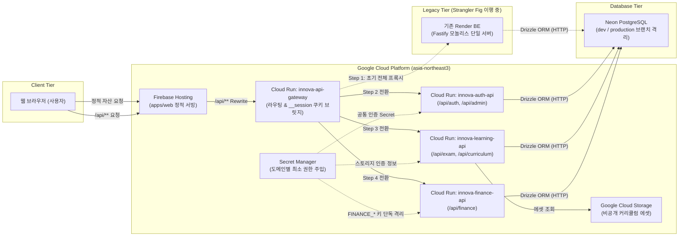

# ADR-0002: Google 생태계·Cloud Run MSA 전환 및 클라우드·에이전트 탈출 전략

- 상태: 승인됨(Accepted)
- 결정일: 2026-11-01
- 적용 범위: 저장소 공통
- 관련 이슈: Linear [PIN-71](https://linear.app/pin-dev/issue/PIN-71), [PIN-73](https://linear.app/pin-dev/issue/PIN-73)

## 1. 맥락과 문제 정의 (Context)

- **개발 도구 및 구독 통합 배경**:
  - 기존에는 ChatGPT Plus(Codex) 개별 구독을 기반으로 개발을 진행해 왔다.
  - Google AI Pro 연간 구독 40% 할인을 계기로, AI 에이전트 개발 환경(Antigravity / Gemini), Google Cloud 월 $10 크레딧, 5TB 스토리지를 단일 구독으로 통합하여 비용 및 관리 효율을 극대화할 수 있는 기회가 마련되었다.
  - 아울러 특정 AI 도구와 단일 클라우드에 국한되지 않고, 다양한 AI 코딩 에이전트(Codex, Antigravity, Claude, Grok 등)와 클라우드 생태계를 직접 사용·비교해 보는 실증적 학습 경험을 확보하고자 한다.
- **인프라 전환 및 고수준 PaaS 추상화 탈피**:
  - 기존 운영 인프라는 Vercel(Web) + Render(Fastify 단일 서버) + Neon PostgreSQL(DB) 조합이었다.
  - Vercel과 Render는 배포가 간편하지만, 컨테이너 라이프사이클, API Gateway, 도메인별 라우팅, IAM/Secret 격리 등 핵심 클라우드 엔지니어링 영역을 플랫폼 뒤로 추상화해 가려둔다.
  - 또한 기존 Render 무료/저가형 환경의 심각한 Spin-down 콜드 스타트 지연과 리전 제약으로 인해 사용자 경험이 저하되는 문제가 지속되었다.
  - 이에 따라 Google Cloud Run(서울 `asia-northeast3` 리전)을 기반으로 컨테이너 기반 마이크로서비스 아키텍처(MSA)를 직접 설계·구현하여 성능과 엔지니어링 역량을 동시에 확보하고자 한다.
- **예산 제약과 하이브리드 서버리스 구성**:
  - 구독에 포함된 Google Cloud 월 $10 크레딧 한도 내에서 운영해야 하므로, 상시 구동 고정 비용이 큰 Cloud SQL 도입은 불가능하다.
  - 따라서 Serverless Scale-to-Zero가 가능한 Cloud Run과 비용 효율적인 Neon PostgreSQL(`dev`/`production` 브랜치 격리 및 `FOR KEY SHARE` 원자적 잠금 검증 완료)을 결합한 실용적 하이브리드 아키텍처가 요구된다.
- **점진적 전환(Strangler Fig) 및 벤더 탈출 전략(Exit Strategy) 필수성**:
  - 운영 중인 서비스에 영향을 주지 않으면서 전환을 달성하려면 한 번에 모든 것을 바꾸는 빅뱅 방식 대신 Strangler Fig(점진적 라우팅 전환) 패턴을 적용해야 한다.
  - 또한 연간 40% 할인 구독 기간이 종료되거나 클라우드 요금 정책이 변경될 경우를 대비해, 애플리케이션 코드 수정 없이 타 클라우드·저가형 VPS·홈랩으로 즉시 이전할 수 있는 **클라우드 탈출 전략(Cloud Exit Strategy)**이 처음부터 보장되어야 한다.
  - AI 작업 지침 역시 특정 벤더에 종속되지 않는 범용 체계를 유지해야 한다.

## 2. 검토한 대안 (Considered Options)

### 대안 1: 기존 구독(ChatGPT Plus / Codex) 및 기존 인프라(Vercel + Render + Neon) 모두 유지
- **개요**: AI 개발 도구와 배포 인프라를 변경하지 않고 현행 구성을 유지하는 방식.
- **장점**:
  - 추가 인프라 구축 및 마이그레이션 공수가 전혀 들지 않는다.
  - 기존 도메인 기능 개발 마일스톤과 이슈 일정을 계획대로 진행할 수 있다.
- **단점 및 미채택 사유**:
  - AI 구독, 스토리지, 클라우드 비용이 분산되어 연간 40% 할인 통합 혜택을 활용하지 못한다.
  - Render의 긴 콜드 스타트 지연이 지속되어 사용자 경험이 개선되지 않는다.
  - 고수준 PaaS의 추상화 뒤에 머물러 컨테이너, API Gateway, 도메인별 MSA 라우팅, IAM/Secret 관리 및 다중 AI 에이전트 비교 학습의 기회를 얻지 못한다.

### 대안 2: AI 구독·개발 도구만 Google AI Pro로 변경하고, 인프라는 기존(Vercel + Render + Neon) 유지
- **개요**: 개발 환경 구독만 Google AI Pro(Antigravity)로 전환하고, 웹·API 운영 인프라는 기존 Vercel과 Render를 그대로 유지하는 방식.
- **장점**:
  - 인프라 이행 작업이 발생하지 않으므로 기존 기능 개발 일정을 지연시키지 않는다.
  - 구독 통합에 따른 비용 절감과 AI 코딩 도구 비교 학습 효과를 즉시 얻을 수 있다.
- **단점 및 미채택 사유**:
  - Google AI Pro 구독에 기본 제공되는 월 $10 Google Cloud 크레딧을 실제 운영 인프라에 쓰지 못하고 버리게 된다.
  - 기존 Render의 콜드 스타트 지연과 리전 제약이 해소되지 않는다.
  - 클라우드 엔지니어링 역량을 실전에 내재화하고 인프라 수준의 벤더 락인을 방지하려는 기술적 목표를 달성할 수 없다.

### 대안 3: AI 구독·개발 도구와 인프라(Firebase Hosting + Cloud Run MSA + GCS + Neon)를 함께 전환 + 클라우드·에이전트 탈출 전략 수립 (채택안)
- **개요**: 구독을 Google AI Pro로 통합하여 비용 효율을 극대화하고, 월 $10 크레딧을 활용해 Frontend(Firebase Hosting), API Gateway(Cloud Run), 도메인별 3대 마이크로서비스(Cloud Run), 비공개 에셋(GCS), DB(Neon 유지)로 하이브리드 서버리스 MSA를 Strangler Fig 패턴으로 점진 구축하며, 구독 종료에 대비한 탈출 패키지(`docker-compose.yml` + `SERVICE_DOMAINS=all`) 및 범용 에이전트 지침을 함께 완결하는 방식.
- **장점**:
  - 단일 구독으로 AI 개발 환경, 월 $10 클라우드 크레딧, 5TB 스토리지를 통합 활용하여 TCO를 최적화한다.
  - 서울 리전(`asia-northeast3`) Cloud Run을 통해 Render의 콜드 스타트 및 리전 지연을 획기적으로 개선한다.
  - 컨테이너 패키징, 경량 API Gateway, 도메인별 MSA 분리, Secret Manager 기반 최소 권한 격리(`FINANCE_*`)를 직접 설계하여 클라우드 엔지니어링 역량을 내재화한다.
  - Cloud SQL 대신 Neon PostgreSQL을 유지함으로써 월 $10 크레딧 한도 내에서 안전하게 서버리스를 운영한다.
  - 클라우드 탈출 전략(`docker-compose.yml`)과 범용 AI 에이전트 지침으로 인프라와 개발 도구 양면에서 벤더 락인을 완전히 차단한다.
- **단점 및 위험 요소**:
  - 인프라 전환 및 MSA 분리 작업([PIN-71](https://linear.app/pin-dev/issue/PIN-71) 하위 [PIN-73](https://linear.app/pin-dev/issue/PIN-73)~[PIN-78](https://linear.app/pin-dev/issue/PIN-78))이 선행됨에 따라 기존 도메인 기능 마일스톤과 예정된 제품 이슈들의 완료 일정이 전체적으로 지연되는 시간적·우선순위적 기회비용이 발생한다.
  - API Gateway 도입에 따른 추가 네트워크 홉과 Firebase Hosting의 `__session` 단일 쿠키 브릿지 제약 대응이 필요하다.
  - 다중 서비스 배포 파이프라인 관리 복잡도가 증가한다.

## 3. 결정 (Decision)

본 프로젝트는 **대안 3을 최종 채택**하며, 다음과 같은 아키텍처 규칙과 전환 원칙을 확정한다.

### 1) AI 개발 환경 및 벤더 중립적 지침 체계
- 주 개발 환경은 Google AI Pro(Antigravity / Gemini)를 활용하되, 저장소의 공통 지침(`AGENTS.md`)과 운영 정책 문서는 특정 도구(Codex, Antigravity, Claude, Grok 등)에 종속되지 않는 **범용 AI 에이전트 기준**으로 유지한다.
- 향후 어떤 AI 코딩 도구로 전환하더라도 추가 지침 개편 없이 동일하게 일관된 워크플로를 보장한다.

### 2) 하이브리드 서버리스 MSA 아키텍처 구성
- **Frontend**: Vercel에서 **Firebase Hosting**으로 전환한다.
  - `apps/web/dist`의 정적 빌드 산출물을 글로벌 CDN으로 서빙한다.
  - `/api/**` 경로 요청은 API Gateway Cloud Run으로 Rewrite 전달한다.
- **API Gateway**: **Cloud Run 기반 경량 API Gateway (`innova-api-gateway`, `asia-northeast3`)**를 구축한다.
  - 초기에는 모든 `/api/**` 트래픽을 기존 Render BE로 투명 프록시 전달한다.
  - 도메인별 마이크로서비스가 준비되는 순서대로 라우팅 경로를 점진적으로 전환한다.
  - Firebase Hosting의 쿠키 전달 제약에 대응하여 `__session` 쿠키 브릿지 처리를 포함한다.
- **Backend Microservices**: 단일 Fastify 모노레포 코드베이스를 유지하되, `SERVICE_DOMAINS` 환경 변수로 라우트 등록 범위를 제어하여 3개의 독립 Cloud Run 서비스(`asia-northeast3`, Scale-to-Zero)로 배포한다.
  1. `innova-auth-api`: 인증 및 사용자 관리 (`/api/auth/**`, `/api/admin/**`)
  2. `innova-learning-api`: Exam Drill 및 커리큘럼 학습 (`/api/exam/**`, `/api/curriculum/**`)
  3. `innova-finance-api`: MOTIFIN 가계부 및 금융 분석 (`/api/finance/**`)
- **Storage & Database**:
  - 커리큘럼 비공개 에셋은 Vercel Private Blob에서 **Google Cloud Storage(GCS)** 버킷으로 1:1 이전하여 서빙한다.
  - 데이터베이스는 월 $10 크레딧 한도 보호 및 고정 인스턴스 비용 회피를 위해 **Neon PostgreSQL을 유지**하며, 기존의 `dev`/`production` 브랜치 격리와 `FOR KEY SHARE` 동시성 원자적 잠금을 계승한다.
- **Config & Secret Management**:
  - 도메인별 환경 변수와 비밀 값은 **Google Cloud Secret Manager**를 통해 각 Cloud Run 서비스에만 최소 권한으로 분리 주입한다.
  - 특히 금융 암호화 키(`FINANCE_*`)는 `innova-finance-api`에만 단독 주입하여 보안 경계를 격리한다.

### 3) Strangler Fig 기반 5단계 점진적 전환
운영 중인 시스템에 장애나 중단이 발생하지 않도록 다음 순서로 단계를 분리하여 실행한다.
- **Step 1 ([PIN-74](https://linear.app/pin-dev/issue/PIN-74))**: Firebase Hosting(FE) + Cloud Run `innova-api-gateway` 구축 및 기존 Render BE 프록시 연동 (기존 Render BE 무수정 유지).
- **Step 2 ([PIN-75](https://linear.app/pin-dev/issue/PIN-75))**: `innova-auth-api` 분리 및 API Gateway에서 `/api/auth/**`, `/api/admin/**` 라우팅 전환.
- **Step 3 ([PIN-76](https://linear.app/pin-dev/issue/PIN-76))**: `innova-learning-api` 분리, 비공개 에셋 GCS 1:1 이전 및 `/api/exam/**`, `/api/curriculum/**` 라우팅 전환.
- **Step 4 ([PIN-77](https://linear.app/pin-dev/issue/PIN-77))**: `innova-finance-api` 분리, 금융 키 격리 주입 및 `/api/finance/**` 라우팅 전환 (MSA 전환 완료).
- **Step 5 ([PIN-78](https://linear.app/pin-dev/issue/PIN-78))**: 트래픽 완전 전환 검증 후 `FINANCE_ALLOWED_ORIGINS` 정리, 기존 Render/Vercel 중지, `@vercel/blob`·`vercel.json` 제거 및 클라우드 탈출 패키지 확정.

각 단계 진행 시 Preview(`dev` 브랜치/PR: Firebase Preview + `dev` Cloud Run + Neon `dev` DB)와 Production(`main` 브랜치: Firebase Prod + `prod` Cloud Run + Neon `production` DB) 배포 자동화를 함께 내재화한다.

### 4) 클라우드 탈출 전략(Cloud Exit Strategy) 의무화
- 모든 백엔드 서비스는 GCP 전용 SDK나 독점 기능에 비즈니스 로직을 강결합하지 않고, 표준 컨테이너(OCI) 및 HTTP 인터페이스, 추상화된 스토리지 어댑터를 유지한다.
- 모노레포 내에 `SERVICE_DOMAINS=all` 환경 변수와 통합 `docker-compose.yml`을 유지하여, 필요 시 단일 컨테이너 모놀리스로 즉시 기동할 수 있도록 보장한다.
- 연간 40% 할인 만료나 요금제 변경 시 애플리케이션 코드 수정 없이 타 클라우드, 저가형 VPS(예: Hetzner, DigitalOcean) 또는 홈랩으로 언제든 즉시 이전할 수 있어야 한다.

## 4. 결과와 영향 (Consequences)

### 긍정적 영향 (Pros)
- **TCO 최적화 및 학습 가치**: 연간 40% 할인 단일 구독으로 AI 개발 환경, 월 $10 인프라 크레딧, 5TB 스토리지를 묶어 비용을 효율화하고, 다중 AI 및 클라우드 기술을 실증적으로 비교 학습할 수 있다.
- **성능 및 레이턴시 대폭 개선**: 서울 리전(`asia-northeast3`) Cloud Run 기반으로 전환하여 기존 Render 무료/저가 티어의 긴 Spin-down 콜드 스타트 지연과 해외 리전 네트워크 레이턴시를 해소한다.
- **엔지니어링 역량 내재화 및 보안 강화**: 컨테이너, 경량 API Gateway, 도메인별 마이크로서비스 격리 및 Secret Manager를 통한 금융 키(`FINANCE_*`) 단독 주입으로 최소 권한 원칙을 실현한다.
- **벤더 락인 위험 완전 해소**: 클라우드 탈출 패키지(`docker-compose.yml` + `SERVICE_DOMAINS=all`)와 특정 도구에 종속되지 않는 범용 AI 지침을 통해 언제든 인프라와 개발 도구를 자유롭게 교체할 수 있다.

### 감수할 비용 및 트레이드오프 (Cons & Trade-offs)
- **일정 및 우선순위 지연**: 인프라 전환과 MSA 분리 작업([PIN-71](https://linear.app/pin-dev/issue/PIN-71))을 최우선으로 선행함에 따라, 기존에 계획되어 있던 도메인 기능 마일스톤과 후속 제품 이슈들의 완료 일정이 전체적으로 지연되는 시간적·우선순위적 기회비용을 수용한다.
- **네트워크 홉 및 구조적 복잡도**: 브라우저 → Firebase Hosting → API Gateway → 마이크로서비스로 이어지는 계층 구조로 인해 추가 네트워크 홉이 발생하며, Firebase Hosting 특유의 `__session` 단일 쿠키 브릿지 로직을 Gateway에 구현해야 한다.
- **배포 파이프라인 관리 비용**: 단일 Render 서버 배포에서 Gateway 및 3개 마이크로서비스 각각의 Preview/Production 배포 파이프라인(Cloud Build / GitHub Actions)을 유지·관리하는 운영 오버헤드가 발생한다.

### 후속 작업 / 영향받는 영역
- 하위 이슈 순차 실행:
  - [PIN-74](https://linear.app/pin-dev/issue/PIN-74): Firebase Hosting 전환 및 Cloud Run API Gateway 도입 (기존 Render BE 프록시)
  - [PIN-75](https://linear.app/pin-dev/issue/PIN-75): Auth / Admin 마이크로서비스 분리 및 라우팅 전환
  - [PIN-76](https://linear.app/pin-dev/issue/PIN-76): Learning 마이크로서비스 분리 및 에셋 GCS 1:1 이전
  - [PIN-77](https://linear.app/pin-dev/issue/PIN-77): Finance 마이크로서비스 분리 및 라우팅 전환
  - [PIN-78](https://linear.app/pin-dev/issue/PIN-78): 레거시 정리 및 클라우드 탈출 패키지 완결
- 공통 및 앱별 지침 문서(`AGENTS.md`, `apps/*/AGENTS.md`, `docs/ai-workflow.md`, `docs/linear-workflow.md`)를 범용 AI 에이전트 기준으로 정비.
- `docs/documentation-policy.md` 및 `README.md`에 본 ADR(ADR-0002) 링크 반영.
