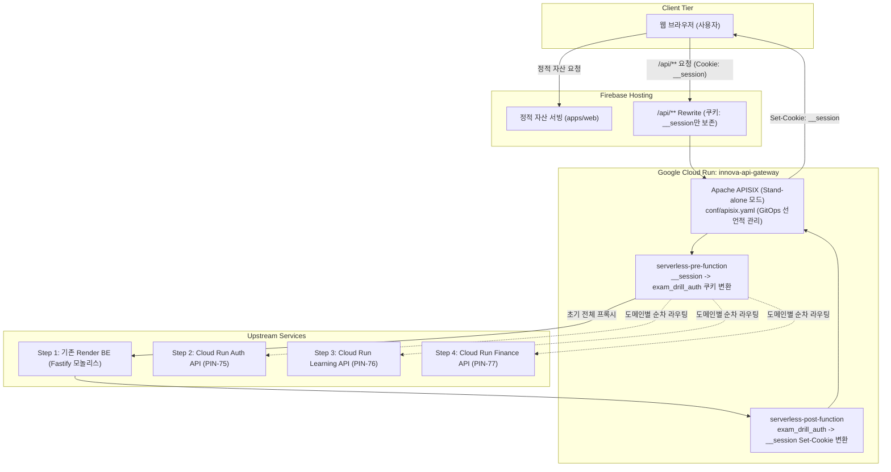

# ADR-0003: Apache APISIX (Stand-alone) API Gateway 채택

- 상태: 승인됨(Accepted)
- 결정일: 2026-11-08
- 적용 범위: 인프라 / API Gateway (`apps/api-gateway`)
- 관련 이슈: Linear [PIN-71](https://linear.app/pin-dev/issue/PIN-71), [PIN-74](https://linear.app/pin-dev/issue/PIN-74)
- 관련 결정: [ADR-0002](0002-google-cloud-run-msa-and-exit-strategy.md)

## 1. 맥락과 문제 정의 (Context)

- **Strangler Fig 점진적 전환과 API Gateway의 필수 역할**:
  - [ADR-0002](0002-google-cloud-run-msa-and-exit-strategy.md)에 따라 기존 Fastify 단일 모놀리스(Render)에서 서울 리전(`asia-northeast3`) Google Cloud Run 기반 도메인별 마이크로서비스(Auth, Learning, Finance)로 점진적 분리·전환을 진행하고 있다.
  - 사용자 관점에서 단일 도메인 및 일관된 `/api/**` 엔드포인트를 유지하면서, 백엔드 서비스를 무중단으로 점진 라우팅(Strangler Fig 패턴)하기 위해 진입점 역할을 담당할 API Gateway 계층이 필수적이다.
- **Firebase Hosting 단일 도메인 및 `__session` 단일 쿠키 제약**:
  - 프런트엔드(`@innova/web`)는 Firebase Hosting을 통해 정적으로 서빙되며, 모든 `/api/**` 요청은 Cloud Run Gateway로 리라이트된다.
  - Firebase Hosting은 CDN 캐시 최적화 및 보안 정책상 백엔드로 `__session` 이름의 쿠키 1개만을 전달하고 그 외의 모든 쿠키(`exam_drill_auth` 등)를 전부 제거(Strip)하여 전달한다.
  - 따라서 API Gateway는 클라이언트와 백엔드 사이에서 `__session` ↔ `exam_drill_auth` 쿠키를 양방향으로 번역·치환(브릿지)해야 한다.
- **자체 프록시 구현 대비 전문 게이트웨이의 필요성**:
  - 초기 프로토타입으로 Node.js(Fastify + Undici) 기반 프록시를 구현·검토하였으나, 고부하 스트리밍 백프레셔, 청크 전송 처리, HTTP/2·HTTP/3 종단, 향후 요구될 Rate Limiting, CORS, 보안 헤더 제어 등 게이트웨이 고유의 비기능적 요구사항을 애플리케이션 코드로 계속 유지보수하는 데 상당한 엔지니어링 비용이 수반된다.
- **Cloud Run 서버리스 제약과 벤더 락인 방지**:
  - Google Cloud 월 $10 크레딧 한도 내에서 운영해야 하므로, Cloud Run의 Serverless Scale-to-Zero(요청이 없을 때 0개 인스턴스로 축소)가 완벽히 동작해야 한다. 상시 구동 분산 코디네이터(`etcd`)나 게이트웨이 설정용 상시 관리형 DB(PostgreSQL 등)를 별도로 운영하는 것은 예산상 불가능하다.
  - 특정 상용 엔터프라이즈 솔루션이나 벤더 정책에 종속되지 않는 지속 가능한 오픈소스 생태계를 보장해야 한다.

## 2. 검토한 대안 (Considered Options)

### 대안 1: 자체 Node.js (Fastify + Undici) 프록시 애플리케이션
- **개요**: Node.js 24 런타임에서 `@fastify/http-proxy` 또는 내장 fetch/undici 라이브러리를 사용하여 리버스 프록시와 쿠키 브릿지를 직접 구현하는 방식.
- **장점**:
  - 모노레포(`pnpm`) 내 기존 TypeScript/Node.js 스택과 일치하여 학습 비용이 적다.
  - 쿠키 파싱 및 조작 로직을 익숙한 코드로 유연하게 작성할 수 있다.
- **단점 및 미채택 사유**:
  - 프록시 스트리밍 처리, 버퍼링, 커넥션 풀링, TLS 처리 등 저수준 네트워크 최적화를 직접 관리해야 한다.
  - 향후 Rate Limiting, JWT 인증, 모니터링 등 표준 게이트웨이 기능이 필요할 때마다 자체 구현 및 유지보수 부담이 누적된다.
  - Node.js 단일 이벤트 루프 특성상 고부하 I/O 및 프록시 처리에 특화된 전용 리버스 프록시 대비 리소스 사용량과 레이턴시에서 불리하다.

### 대안 2: Kong Gateway (OSS)
- **개요**: 가장 널리 사용되는 오픈소스 API Gateway인 Kong을 도입하여 DB-less 모드(`kong.yaml`)로 운영하는 방식.
- **장점**:
  - 방대한 레퍼런스와 풍부한 플러그인 생태계.
  - 선언적 파일 기반(DB-less) 구성 지원.
- **단점 및 미채택 사유**:
  - **오픈소스 Docker 이미지 배포 중단**: Kong은 3.9 버전을 끝으로 공식 오픈소스 Docker prebuilt image(`kong:3.10+`) 배포를 중단하였으며, 최신 버전을 상용 Kong Gateway(Enterprise) 이미지 기반으로 일원화하였다.
  - 최신 버전과 보안 패치를 지속적으로 적용받으려면 비공식 이미지 사용, 소스 직접 빌드 또는 엔터프라이즈 라이선스 종속 위험을 감수해야 하므로 장기적인 벤더 탈출 전략에 어긋난다.
  - Alpine 기반 초경량 공식 이미지가 폐지되어 컨테이너 이미지 크기가 비대하다.

### 대안 3: Apache APISIX (Stand-alone 모드) — 채택안
- **개요**: Apache Software Foundation(ASF)의 최상위 프로젝트이자 Nginx/OpenResty 기반 초고성능 API Gateway인 Apache APISIX를 외부 분산 저장소(`etcd`) 없이 **Stand-alone 모드**(`conf/apisix.yaml`)로 운영하는 방식.
- **장점**:
  - **완전한 오픈소스 (Apache 2.0)**: 벤더 종속이나 라이선스 폐쇄화 우려가 전혀 없으며, 공식 DockerHub 및 GitHub Container Registry에서 최신 릴리스 이미지가 투명하게 제공된다.
  - **극단적인 고성능 및 초저지연**: Nginx 및 LuaJIT 기반 비동기 논블로킹 아키텍처로 Node.js 대비 월등히 낮은 레이턴시와 안정적인 처리량을 보장한다.
  - **Zero External Dependency (단일 컨테이너 Stand-alone)**: `etcd`나 외부 데이터베이스 연결 없이 로컬 선언적 YAML 파일(`conf/apisix.yaml`)만으로 완벽히 구동된다. 상시 인프라 비용 $0, Cloud Run 단일 컨테이너 Scale-to-Zero 및 빠른 콜드 스타트에 최적화된다.
  - **무중단 핫리로드**: `apisix.yaml` 파일 변경 시 프로세스 재기동 없이 1초 주기로 메모리에 핫리로드되며, 파일 작성 완료를 보장하는 `#END` 마커 검증을 지원한다.
  - **강력한 플러그인 생태계 및 확장성**: 내장된 풍부한 플러그인(Rate Limiting, CORS, Proxy Rewrite, Prometheus 메트릭 등)을 즉시 활용할 수 있으며, `serverless-pre-function` 및 `serverless-post-function`을 통해 간결한 Lua 코드로 `__session` 쿠키 브릿지를 완벽하게 구현할 수 있다.
- **단점 및 감수할 요소**:
  - Stand-alone 모드에서는 Web GUI(APISIX Dashboard)를 사용할 수 없다 (대시보드는 `etcd` 의존 필수).
  - 런타임 Admin REST API를 통한 동적 라우트 주입이 불가능하며 모든 변경은 파일 수정을 통해 이루어진다.

## 3. 결정 (Decision)

1. **Apache APISIX (Stand-alone 모드) 채택**:
   - `innova-api-gateway`의 기반 프레임워크로 Apache APISIX를 채택하고, 분산 저장소(`etcd`)가 없는 **Stand-alone 모드**로 운영한다.
   - 단일 컨테이너로 패키징하여 서울 리전(`asia-northeast3`) Cloud Run에 배포한다.

2. **GitOps 기반 선언적 라우팅 관리**:
   - 모든 라우트, 업스트림, 플러그인 규칙은 코드베이스 내 선언적 YAML 파일(`conf/apisix.yaml`)로 일원화하여 관리한다.
   - Web Dashboard를 배제하고 Git PR 리뷰와 CI/CD 배포 파이프라인을 통해서만 라우팅을 변경함으로써, GUI 휴먼 에러를 방지하고 완벽한 인프라 변경 이력(Audit Trail)을 확보한다.

3. **공개 저장소(Public GitHub) 보안 원칙 (환경 변수 치환 & Zero Trust IAM)**:
   - 오픈소스/공개 저장소 특성상 `apisix.yaml`에 실제 운영 백엔드 URL(Render 및 Cloud Run FQDN)을 하드코딩하지 않는다.
   - APISIX 내장 환경 변수 문법(`${{ UPSTREAM_RENDER_URL }}`, `${{ UPSTREAM_AUTH_URL }}`) 또는 컨테이너 기동 시 템플릿 치환(`envsubst`)을 적용하고, 실제 주소는 GitHub Actions Secrets 및 Cloud Run 환경 변수로 주입한다.
   - 향후 MSA 분리 시 Cloud Run 백엔드 서비스는 퍼블릭 비인가 호출을 차단하고, API Gateway 컨테이너의 서비스 어카운트(IAM OIDC ID 토큰)만 허용하는 제로 트러스트(Zero Trust) 보안 아키텍처를 적용한다.

4. **Firebase Hosting `__session` 쿠키 브릿지 설계**:
   - `serverless-pre-function` (요청 시): 클라이언트가 전달한 `Cookie: __session=<TOKEN>` 헤더를 파싱하여 백엔드가 인식하는 `Cookie: exam_drill_auth=<TOKEN>` 헤더로 변환하여 업스트림에 전달한다.
   - `serverless-post-function` (응답 시): 업스트림 백엔드가 반환한 `Set-Cookie: exam_drill_auth=<TOKEN>` 헤더를 감지하여 `Set-Cookie: __session=<TOKEN>; Path=/; SameSite=Lax; Secure; HttpOnly`로 재작성하여 브라우저에 응답한다.

## 4. 결과와 영향 (Consequences)

### 긍정적 영향 (Pros)
- **영구적인 오픈소스 생태계 및 벤더 독립성**: Apache 2.0 라이선스로 운영 정책 폐쇄화나 라이선스 종속 위험이 전혀 없으며 장기적인 클라우드 탈출 전략을 온전히 지탱한다.
- **Cloud Run 서버리스 비용 최적화 ($0 Scale-to-Zero)**: 분산 저장소(`etcd`) 및 관리형 DB 운영 비용 없이 단일 컨테이너로 구동되어 월 $10 크레딧 범위 내에서 경제적으로 운영된다.
- **엔터프라이즈급 성능 및 기능성**: Nginx/LuaJIT 기반 초저지연 프록시 성능을 확보하고 향후 트래픽 제어(Rate Limit, Prometheus, CORS, SSL 종단 등) 요구 시 추가 구현 없이 표준 플러그인 활성화만으로 해결할 수 있다.
- **GitOps 기반 단일 진실 공급원(SSOT)**: 모든 라우팅 규칙이 코드와 함께 Git으로 버전 관리되고 PR 검증을 거치므로 운영 안정성이 극대화된다.

### 감수할 비용 및 트레이드오프 (Cons & Trade-offs)
- **Web Dashboard(GUI) 미사용**: Stand-alone 모드 특성상 웹 GUI 대시보드를 사용할 수 없다. 라우트 추가·변경은 반드시 `apisix.yaml` 수정과 Git 커밋/PR 배포를 거쳐야 한다. (GitOps 관점에서는 오히려 장점으로 작용)
- **Lua 스크립트 작성 및 이해**: 쿠키 브릿지 로직 등 세밀한 커스텀 동작에 OpenResty/Lua 스크립트(`ngx.*` API)가 사용되므로 팀 내 Lua 지식 습득이 필요하다.

### 후속 작업 / 영향받는 영역
- `apps/api-gateway` 패키지 구성:
  - Apache APISIX 공식 이미지 기반 Dockerfile 작성.
  - `conf/apisix.yaml` 및 `conf/config.yaml`(Stand-alone 모드 활성화) 템플릿 작성.
  - `serverless-pre-function` 및 `serverless-post-function` Lua 쿠키 브릿지 스크립트 작성 및 로컬 단위 테스트.
- 환경 변수 주입 및 GitOps 파이프라인 구성:
  - GitHub Actions 워크플로(`.github/workflows/deploy-preview.yml`, `deploy-production.yml`)에 APISIX Gateway 빌드 및 배포 단계 추가.
  - `UPSTREAM_RENDER_URL` 환경 변수 주입 검증.
- `docs/documentation-policy.md` 및 `README.md`에 본 ADR(ADR-0003) 링크 반영.
- Linear 이슈 [PIN-74](https://linear.app/pin-dev/issue/PIN-74) 실행 계획 최신화.
