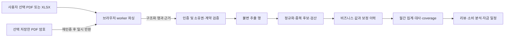

# Personal Finance 구현 아키텍처 (`@innova/finance`)

상태: 현행 기술 아키텍처 기준 (`PIN-67` 확정 정책 및 `PIN-68/69/70` 구현 반영). 제품 기준, 기능별 상세 스펙, 출시/운영 체크리스트는 [Notion @innova/finance 카탈로그](https://app.notion.com/p/42369ba4b33081d58ee5ea9862c01667?pvs=204)에서 소유한다.

## 1. 데이터 파이프라인 및 처리 원칙

- **클라이언트 파싱 & 서버 비보관**: PDF/XLSX 복호화·추출은 브라우저 worker에서 수행하고 구조화 행만 서버로 전송한다. 원파일 바이트와 PDF 평문은 서버에 보관하지 않으며, 서버는 계약·크기·금액·소유권·대사를 재검증한다.
- **정밀 계산**: 금액은 `KRW scale 0` 정수 문자열과 `BigInt`로 계산하며 이진 부동소수점을 사용하지 않는다. `unknown`/빈 값과 `0`을 구분하고 카드대금 출금을 소비에 이중 합산하지 않는다.
- **불변 원천 + 보정 분리**: `finance_raw_*` 불변 원천 위에 `finance_business_*`, `finance_classification_*`, `finance_schedule_*`가 분리된다. 사용자 보정은 `baseRevision`/`expectedRevision` 조건부 CAS와 `operationId` idempotency로 보호하며 재업로드로 덮어쓰지 않는다.

## 2. 계층별 기술 책임

| 계층 | 책임 |
| --- | --- |
| `packages/contracts` | 금액/날짜/coverage/provenance/revision, 가져오기·보정·암호·오류 DTO Zod 계약 |
| `apps/web` (`entities/finance-*`, `features/finance-*`, `pages/finance-*`) | owner·session epoch 분리 Query, 보호 cache 제거, worker 수명 및 `X-Expected-User` 전파 |
| `services/finance/src/routes/` | 인증·approved·소유권·`Origin`/`X-Finance-Request: 1`·`no-store`/`Vary: Cookie`·예외 redaction |
| `services/finance/src/db/` | `(owner_id, id)` 범위 repository, `finance_business_scopes` owner CAS, AEAD 암호화 |

## 3. 보안·암호화·거래 생애주기 경계

- **암호화 및 키 분리**:
  - `FINANCE_RAW_ENCRYPTION_KEY`: Raw·Business·Classification·Schedule·Manual 본문을 목적별 AAD(`finance-raw`, `finance-business`, `finance-classification`, `finance-schedule`)와 CSPRNG 96-bit nonce AES-256-GCM으로 암호화.
  - `FINANCE_PDF_PASSWORD_KEYRING` / `ACTIVE_KEY_VERSION`: 선택 저장 PDF 암호 전용 키링. 최근 5분 재인증(`auth_time`)·`session_hash`·`finance_pdf_secret_nonces`로 보호.
- **거래 생애주기 (`PIN-68/69/70`)**:
  - **수기 거래**: `finance_manual_transactions` 독립 원천.
  - **단건 영구 삭제**: Raw 행·비즈니스 이벤트·보정·일정 참조 정리 및 과거 암호화 이력(`*_revisions`) 즉시 폐기 후 `finance_deleted_transactions` tombstone 보존(재업로드·PITR 복원 시 부활 차단).
  - **XLSX 내보내기**: `POST /api/finance/transactions/export`에서 최대 12개월 4시트를 메모리 스트림으로 생성(PDF 암호·계좌/카드 식별자 제외, 서버 미보관).
- **공통 경계 문서**: 접근·세션·로그·오류 규정은 [개인 데이터 경계 기준](../../../docs/personal-data-boundaries.md), Neon 6h PITR 및 도메인 격리 복구는 [백업·복원 기준](../../../docs/backup-and-recovery.md), 스키마 변경은 [DB 변경 지침](../../../docs/database-migrations.md)을 따른다.

## 4. Notion 기능 스펙 및 출시 문서 (원천 링크)

| 영역 | Notion 원천 |
| --- | --- |
| 제품 기준 및 UX 결정 | [MOTIFIN 제품 기준 및 UX 결정](https://app.notion.com/p/42369ba4b3308172912bfd941eab87fa) |
| Raw 적재 (`PIN-56`) | [[기능] 은행·카드 Raw 파일 적재](https://app.notion.com/p/42369ba4b3308158950ef64371c07f3d) |
| 비즈니스 반영 (`PIN-57/58`) | [[기능] 은행·카드 비즈니스 거래 반영](https://app.notion.com/p/42369ba4b33081ab8759d3806a501137) |
| 분류·보정 (`PIN-59`) | [[기능] 사용자 분류·보정](https://app.notion.com/p/42369ba4b33081d9b193f41a255392de) |
| 월간 리뷰 (`PIN-60`) | [[기능] 월간 리뷰](https://app.notion.com/p/42369ba4b330818a9b9cdcbdcb95d08e) |
| 소비 분석 (`PIN-61`) | [[기능] 관측 소비 분석·월별 비교](https://app.notion.com/p/42369ba4b33081ba9a91dbb6548f2fca) |
| 자금 일정 (`PIN-62`) | [[기능] 자금 일정·이번 달 발견](https://app.notion.com/p/42369ba4b33081389b15fb75cd91fe47) |
| PDF 선택 암호 (`PIN-63`) | [[기능] PDF 선택 암호 저장·재인증](https://app.notion.com/p/42369ba4b33081a5981df304b5598177) |
| 출시 검증·운영 전환 (`PIN-54/64`) | [MOTIFIN 출시 검증과 운영 전환](https://app.notion.com/p/42369ba4b33081b7ae75d4a7332f53f3) |
